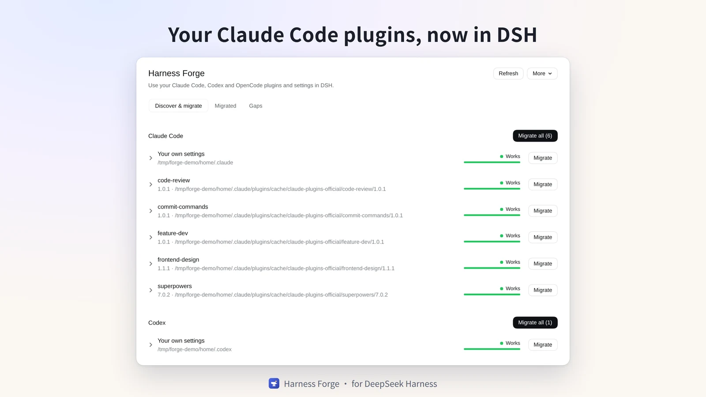
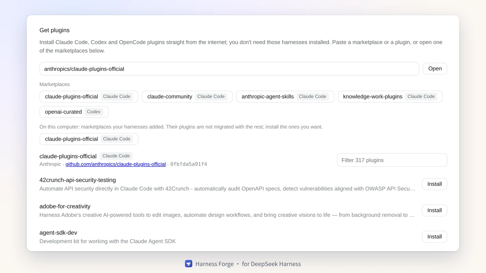
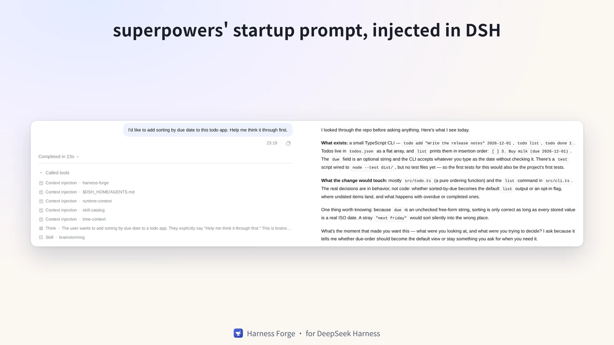
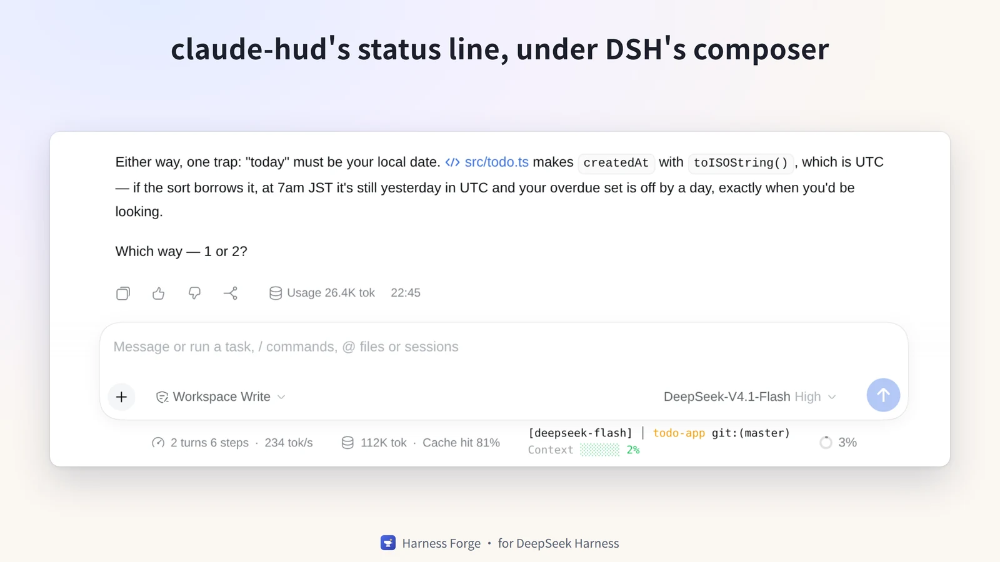

<p align="center">
  
</p>

<h1 align="center">Harness Forge</h1>

<p align="center">
  <b>Use your Claude Code, Codex and OpenCode plugins and settings in <a href="https://github.com/deepseek-ai/deepseek-harness">DeepSeek Harness</a>.</b>
</p>

<p align="center">
  <a href="https://www.npmjs.com/package/@kirkchinese/harness-forge"></a>
  <a href="https://github.com/kirkchinese/harness-forge/actions/workflows/ci.yml"></a>
  <a href="https://github.com/kirkchinese/harness-forge/actions/workflows/e2e.yml"></a>
  <a href="LICENSE"></a>
</p>

<p align="center">English · <a href="README.zh.md">中文</a></p>



## Why

Most plugin authors write for one harness. Harness Forge is a [DeepSeek Harness](https://github.com/deepseek-ai/deepseek-harness) (DSH) plugin that reads the plugins you already have and runs them in DSH:

- **Claude Code** fully: plugins, marketplaces, your `~/.claude` and a project's `.claude/`.
- **Straight from the internet**: paste a Claude Code or Codex marketplace (`owner/repo`, a git URL or a `marketplace.json` URL), a single plugin repository, or an OpenCode npm package, then confirm and install. You don't need the original harness. Anthropic's and OpenAI's marketplaces are listed ready to open.
- **Codex** and **OpenCode**: plugins, your `~/.codex`, OpenCode projects and code plugins.
- **Any harness that uses the common formats**: `SKILL.md` skills, MCP JSON, `AGENTS.md`. Add a folder of skills (with an optional `.mcp.json`) to the plugin folders and it is read as one plugin; Gemini CLI's `~/.gemini/skills` is listed by default. DSH already loads `~/.agents/skills` itself.

It converts at run time through DSH's public extension points. Your original installation stays as it is, and Harness Forge never changes your DSH profile's configuration. Parts DSH has no equivalent for are listed with the reason, and **Fill with AI** can write an adapter for them.



## Install

You need DSH 0.2.2-rc.3 or later and Node.js 22.19+ or 24+, on Windows, Linux or macOS.

In DSH, open **Plugins › Add plugin**, enter `@kirkchinese/harness-forge` and install. It goes into the profile you are using.

Or from a terminal, for the main profile that `dsh web` runs:

```sh
dsh plugin --profile web add @kirkchinese/harness-forge
```

then start DSH again. For another profile, put its name in place of `web`; the desktop app installs through **Plugins › Add plugin** only.

## Quick start

1. **Open Harness Forge** in the DSH sidebar. **Discover & migrate** lists the Claude Code, Codex and OpenCode plugins found on this computer, plus your own settings. Each part is marked as working, partly working or not possible, with the reason.
2. **Migrate.** Press **Migrate all**, or migrate one plugin at a time. You can switch single parts off or undo a migration later in **Migrated**.
   No Claude Code here? Under **Get plugins**, open a marketplace such as `anthropics/claude-plugins-official`, or paste `owner/repo` or an npm package, and install from the internet.
3. **Work.** Start a session. Skills are in the skill catalog, commands are in the `/` menu, agents can take delegated tasks, and hooks fire on their events.



*A real DSH session: superpowers, migrated from Claude Code. Its SessionStart hook injects the startup prompt, and the model loads the brainstorming skill on its own.*

More in the [quick start](docs/user/quickstart.md).

## What carries over

| From the original harness | In DSH |
|---|---|
| Skills (`SKILL.md`) | In DSH's skill catalog, served from where they are installed. `${CLAUDE_SKILL_DIR}`, `${CLAUDE_PLUGIN_ROOT}` and `` !`command` `` are expanded; `allowed-tools`, `model`, `effort` and `context: fork` apply |
| Slash commands | `/<plugin>-<command>`. `$ARGUMENTS`, `$0`, named arguments, `!` commands and `@file` work as in Claude Code. Codex prompts and OpenCode commands too |
| Subagents | DSH agent presets with their own prompt, tool list, model, skills, MCP servers and `maxTurns`, offered through one delegation tool |
| Hooks | Claude Code and Codex hooks from plugins, settings and skill/agent/command frontmatter, run by one broker. Matchers see the original tool names (`Bash`, `Edit`, …) |
| MCP servers | stdio, Streamable HTTP and SSE, with OAuth sign-in. Claude Code tool names are kept (`mcp__plugin_<plugin>_<server>__<tool>`) |
| Code plugins | Claude Code mods, and OpenCode plugins, each in its own Bun process |
| Your own setup | Skills, commands, agents, MCP servers, hooks, settings and permission rules from `~/.claude` and `~/.codex`, and a project's `.claude/` |
| Instruction files | The ones DSH does not read itself: `~/.claude/CLAUDE.md`, `.claude/CLAUDE.md`, `@path` imports, Codex's global `AGENTS.md` |
| Session history | Claude Code, Codex and OpenCode sessions, imported as DSH sessions you can continue |

## What does not carry over

Every part that cannot fully run is shown in **Gaps** with its reason. The reasons come from these limits:

- **UI surfaces** (status lines, themes, workflows, monitors, MCP apps) have no direct DSH equivalent. **Fill with AI** can write one.
- **Output styles** are added to the system prompt. They cannot remove DSH's own coding instructions.
- **Hook events DSH never raises** do not fire. `PreCompact`, `PostCompact`, `Notification` and `StopFailure` hooks run after the fact and cannot block.
- **Hook handler types** other than `command`, `http`, `mcp_tool`, `prompt` and `agent` stay inert.
- **Unmapped plugin parts**: LSP servers, `bin/` executables and install-time `userConfig` options are listed, not run.
- **Code plugins** use a compatibility layer for their host API. A call outside the supported part of that API fails.
- **Codex app connectors** are hosted by OpenAI and only work signed in there. Nothing local can stand in for them.
- An MCP server whose transport cannot be determined is skipped.

Details in [compatibility](docs/user/compatibility.md).

## Fill with AI

Next to a gap an adapter could fill, **Fill with AI** writes a task brief for that part: the original's files, why it cannot run, the nearest DSH extension points and how to check the result. It then opens a session in DSH's own creation mode (agent preset `cordis`) with that brief. The agent there builds a local DSH plugin named `dsh-adapter-<plugin>-<part>` that calls the original plugin's code, installs it in your profile and checks it. Publishing it is up to you, under your own npm scope. See [porting](docs/user/porting.md).



## Rows

Harness Forge is one npm package with several plugin rows. Each row can be switched off on its own in DSH's **Plugins** page; a row that fails to start is logged and the others keep running. Every row needs the main **Harness Forge** row.

| Row | What it does |
|---|---|
| Harness Forge (`harness-forge`) | Discovery, migration, undo and removal; imported settings; `/harness` and the `harness_*` model tools |
| Skills | Imported `SKILL.md` skills and their frontmatter |
| Commands | Imported slash commands and Claude Code output styles (`/output-style`) |
| Agents | Imported agents as DSH agent presets |
| Hooks | Claude Code and Codex hooks, Codex `notify` and global instructions |
| MCP servers | Imported MCP servers and their sign-in |
| Claude Code mods | Claude Code mods, one engine per session |
| OpenCode plugins | OpenCode code plugins in Bun |
| Instructions | Instruction files DSH does not read itself; yields to Recollect when it is installed |
| Sessions | Importing Claude Code, Codex and OpenCode sessions |
| Porting | **Fill with AI** |
| Workbench | The **Harness Forge** page in the sidebar |

Turning a row off removes what it mounted; the parts it served show as inactive in the workbench. See [architecture](docs/architecture/overview.md).

## Works well with

Separate, optional DSH plugins. Harness Forge uses them when they are installed:

- [Capability catalog](https://github.com/kirkchinese/dsh-capability-catalog) (`@kirkchinese/dsh-capability-catalog`): imported stdio MCP servers go through its compact index.
- [Recollect](https://github.com/kirkchinese/DSH-Recollect) (`@kirkchinese/dsh-recollect`): memory and instruction files; Harness Forge's Instructions row steps aside for it.
- [dsh-chat-import](https://github.com/Nwflower/dsh-chat-import) (`dsh-chat-import`): imports conversations from Claude Code, Codex, OpenCode and 40+ other agents as DSH sessions you can continue. Harness Forge's session import steps aside for it; **Install** on the first-run banner or under **More → Import sessions** installs it through DSH's plugin manager.

## Safety

Migrated hooks, MCP servers and plugin code run with your permissions, as they do in their original harness. Migrate only plugins you trust. Before a plugin from the internet is installed, Harness Forge shows its source, exact commit and parts, and warns about parts that run code. On Windows, hooks run in Git Bash (as in Claude Code); elsewhere in bash.

## Documentation

[Quick start](docs/user/quickstart.md) · [Compatibility](docs/user/compatibility.md) · [Porting](docs/user/porting.md) · [Architecture](docs/architecture/overview.md) · [Development](docs/contributing/development.md) · [Changelog](CHANGELOG.md)

## Development

```sh
pnpm install
pnpm build       # core, plugin and the workbench bundle
pnpm typecheck
pnpm test
pnpm e2e         # real DSH on PATH, scripted model, in-repo fixtures
```

| Package | Role |
|---|---|
| [`packages/core`](packages/core) (`@kirkchinese/harness-forge-core`) | Pure logic: dialect scanning, component model, planning, assessment, instruction discovery, session parsing, port briefs |
| [`packages/plugin`](packages/plugin) (`@kirkchinese/harness-forge`) | The DSH plugin and its rows |
| [`packages/testkit`](packages/testkit) | Private end-to-end smoke test |

See [development](docs/contributing/development.md). Issues and pull requests are welcome; for a plugin that does not work, name the plugin and what you expected.

## License

[MIT](LICENSE)
