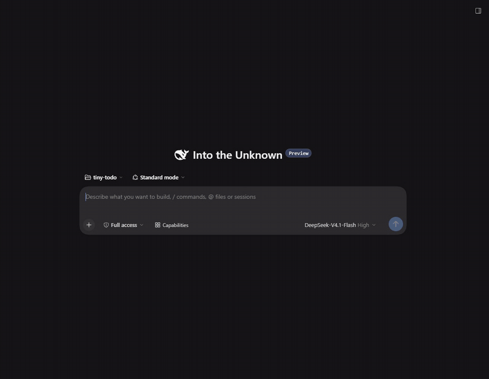
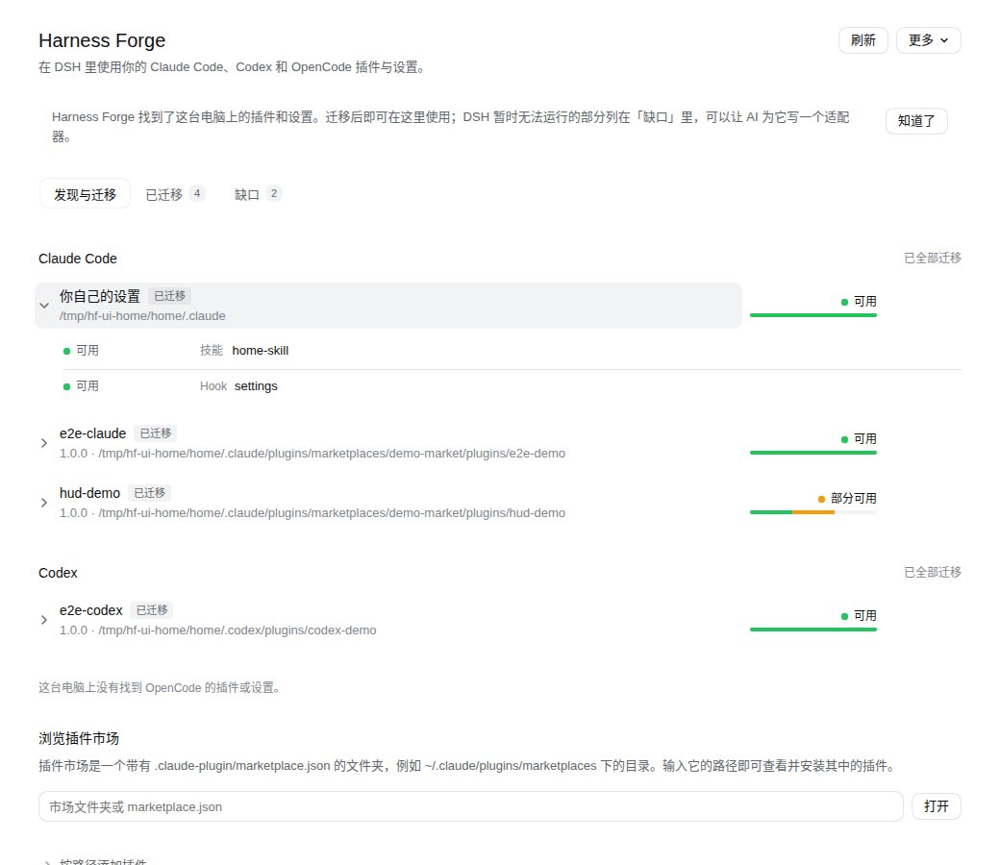

<p align="center">
  
</p>

<h1 align="center">Harness Forge</h1>

<p align="center">
  <b>在 <a href="https://github.com/deepseek-ai/deepseek-harness">DeepSeek Harness</a> 里使用你的 Claude Code、Codex 和 OpenCode 插件与设置。</b>
</p>

<p align="center">
  <a href="https://www.npmjs.com/package/@kirkchinese/harness-forge"></a>
  <a href="https://github.com/kirkchinese/harness-forge/actions/workflows/ci.yml"></a>
  <a href="https://github.com/kirkchinese/harness-forge/actions/workflows/e2e.yml"></a>
  <a href="LICENSE"></a>
</p>

<p align="center"><a href="README.md">English</a> · 中文</p>



*真实的 DSH 会话：superpowers 插件从 Claude Code 迁移过来，模型自己加载了它的 brainstorming 技能。*

## 为什么

大多数插件作者只为一个工具写插件。Harness Forge 是一个 [DeepSeek Harness](https://github.com/deepseek-ai/deepseek-harness)（DSH）插件，它读取你已经装好的插件，让它们在 DSH 里运行：

- **Claude Code**（完整支持）：插件、插件市场、你的 `~/.claude` 和项目里的 `.claude/`；
- **Codex** 和 **OpenCode**：插件、你的 `~/.codex`、OpenCode 项目和代码插件；
- **任何使用通用格式的工具**：`SKILL.md` 技能、MCP JSON、`AGENTS.md`。把一个技能文件夹（可附带 `.mcp.json`）加进插件文件夹，它就作为一个插件读取；默认已列出 Gemini CLI 的 `~/.gemini/skills`。`~/.agents/skills` 由 DSH 自己加载。

转换在运行时通过 DSH 的公开扩展点完成。原来的安装保持原样，Harness Forge 也从不修改你 DSH profile 的配置。DSH 没有对应功能的部分会列出原因，并可以用 **用 AI 补上** 写一个适配器。

## 安装

需要 DSH 0.2.2-rc.3 或更新版本、Node.js 22.19+ 或 24+，支持 Windows、Linux、macOS。

在 DSH 里打开 **插件 › 添加插件**，输入 `@kirkchinese/harness-forge` 并安装，它会装进你正在使用的 profile。

也可以在终端里装到 `dsh web` 使用的主 profile：

```sh
dsh plugin --profile web add @kirkchinese/harness-forge
```

然后重新启动 DSH。要装到其他 profile，把 `web` 换成它的名字；桌面版只能通过 **插件 › 添加插件** 安装。

## 三步上手

1. **打开 Harness Forge**（DSH 侧边栏）。**发现与迁移** 列出这台电脑上找到的 Claude Code、Codex、OpenCode 插件和你自己的设置，逐项标出可用、部分可用或无法使用，并写明原因。
2. **迁移。** 点 **全部迁移**，或逐个插件迁移。之后可以在 **已迁移** 里关闭单个部分或撤销迁移。
3. **使用。** 新开一个会话。技能在技能目录里，命令在 `/` 菜单里，智能体可以接受委派，hook 在对应事件上触发。



详见 [快速开始](docs/user/quickstart.zh.md)。

## 能带过来什么

| 原工具里的 | 在 DSH 里 |
|---|---|
| 技能（`SKILL.md`） | 进入 DSH 技能目录，直接从原安装位置读取。展开 `${CLAUDE_SKILL_DIR}`、`${CLAUDE_PLUGIN_ROOT}` 和 `` !`command` ``；`allowed-tools`、`model`、`effort`、`context: fork` 生效 |
| 斜杠命令 | `/<插件>-<命令>`。`$ARGUMENTS`、`$0`、命名参数、`!` 命令和 `@文件` 与 Claude Code 一致；Codex 提示词和 OpenCode 命令同样可用 |
| 子代理 | 成为 DSH 智能体预设，带自己的提示词、工具列表、模型、技能、MCP 服务和 `maxTurns`，通过一个委派工具提供 |
| Hook | 插件、设置以及技能/智能体/命令 frontmatter 里的 Claude Code 和 Codex hook，由一个 broker 执行；匹配器看到的是原来的工具名（`Bash`、`Edit`……） |
| MCP 服务 | stdio、Streamable HTTP、SSE，支持 OAuth 登录；保留 Claude Code 的工具名（`mcp__plugin_<插件>_<服务>__<工具>`） |
| 代码插件 | Claude Code mods；OpenCode 插件，每个在自己的 Bun 进程里 |
| 你自己的设置 | `~/.claude`、`~/.codex` 和项目 `.claude/` 里的技能、命令、智能体、MCP 服务、hook、设置和权限规则 |
| 指令文件 | DSH 自己不读的那些：`~/.claude/CLAUDE.md`、`.claude/CLAUDE.md`、`@path` 导入、Codex 的全局 `AGENTS.md` |
| 历史会话 | Claude Code、Codex、OpenCode 的会话，导入为可以接着聊的 DSH 会话 |

## 带不过来什么

无法完整运行的部分都在 **缺口** 页列出，并附上原因。原因来自以下限制：

- **界面类**（状态栏、主题、工作流、监视器、MCP 应用）在 DSH 里没有直接对应，可以 **用 AI 补上**；
- **输出风格** 加到系统提示里，不能去掉 DSH 自己的编码指令；
- **DSH 不触发的 hook 事件** 不会运行；`PreCompact`、`PostCompact`、`Notification`、`StopFailure` 的 hook 在事后运行，不能拦截；
- `command`、`http`、`mcp_tool`、`prompt`、`agent` 以外的 **hook 处理器类型** 不执行；
- **未映射的插件部分**：LSP 服务、`bin/` 下的可执行文件、安装时的 `userConfig` 选项只列出，不运行；
- **代码插件** 通过兼容层调用宿主 API，超出已支持部分的调用会失败；
- **Codex 应用连接器** 由 OpenAI 托管，只能在那边登录使用，本地无法替代；
- 无法判断传输方式的 MCP 服务会跳过。

详见 [兼容性](docs/user/compatibility.zh.md)。

## 用 AI 补上

能由适配器补上的缺口旁边有 **用 AI 补上**。它为这个部分写一份任务说明：原插件的文件、为什么无法运行、最接近的 DSH 扩展点、怎么验收；然后带着说明在 DSH 自己的创造模式（智能体预设 `cordis`）里开一个会话。那里的智能体编写一个名为 `dsh-adapter-<插件>-<部分>` 的本地 DSH 插件，调用原插件自己的代码，装进你的 profile 并检查效果。是否发布由你决定，发布在你自己的 npm scope 下。见 [移植](docs/user/porting.zh.md)。

## 插件行

Harness Forge 是一个 npm 包，包含多个插件行（row）。每一行都可以在 DSH 的 **插件** 页面里单独关闭；某一行启动失败只会记录日志，其他行照常运行。所有行都需要 **Harness Forge** 主行。

| 行 | 作用 |
|---|---|
| Harness Forge（`harness-forge`） | 发现、迁移、撤销和移除；导入的设置；`/harness` 命令和 `harness_*` 模型工具 |
| 技能 | 导入的 `SKILL.md` 技能及其 frontmatter |
| 命令 | 导入的斜杠命令和 Claude Code 输出风格（`/output-style`） |
| 智能体 | 导入的智能体，作为 DSH 智能体预设 |
| 钩子 | Claude Code 和 Codex 的 hook，Codex 的 `notify` 和全局指令 |
| MCP 服务器 | 导入的 MCP 服务及其登录 |
| Claude Code mods | Claude Code mods，每个会话一个引擎 |
| OpenCode 插件 | 在 Bun 中运行的 OpenCode 代码插件 |
| 指令文件 | DSH 自己不读的指令文件；装有 Recollect 时让位 |
| 会话导入 | 导入 Claude Code、Codex、OpenCode 会话 |
| 移植 | **用 AI 补上** |
| 工作台 | 侧边栏里的 **Harness Forge** 页面 |

关闭一行会撤下它挂载的内容，它负责的部分在工作台里显示为未启用。见 [架构](docs/architecture/overview.zh.md)。

## 搭配使用

两个独立的可选 DSH 插件，装了之后 Harness Forge 会配合使用：

- [能力目录](https://github.com/kirkchinese/dsh-capability-catalog)（`@kirkchinese/dsh-capability-catalog`）：导入的 stdio MCP 服务经它的精简索引提供；
- [Recollect](https://github.com/kirkchinese/DSH-Recollect)（`@kirkchinese/dsh-recollect`）：记忆与指令文件；Harness Forge 的指令文件行会让位给它。

## 安全

迁移来的 hook、MCP 服务和插件代码以你的权限运行，与在原工具里相同。只迁移你信任的插件。Windows 上 hook 在 Git Bash 中运行（与 Claude Code 相同），其他系统用 bash。

## 文档

[快速开始](docs/user/quickstart.zh.md) · [兼容性](docs/user/compatibility.zh.md) · [移植](docs/user/porting.zh.md) · [架构](docs/architecture/overview.zh.md) · [开发](docs/contributing/development.zh.md) · [更新日志](CHANGELOG.md)

## 开发

```sh
pnpm install
pnpm build       # core、plugin 和工作台 bundle
pnpm typecheck
pnpm test
pnpm e2e         # PATH 上的真实 DSH、脚本化模型、仓库内的测试夹具
```

| 包 | 作用 |
|---|---|
| [`packages/core`](packages/core)（`@kirkchinese/harness-forge-core`） | 纯逻辑：方言扫描、组件模型、计划、评估、指令文件发现、会话解析、移植说明 |
| [`packages/plugin`](packages/plugin)（`@kirkchinese/harness-forge`） | DSH 插件及其各行 |
| [`packages/testkit`](packages/testkit) | 私有的端到端冒烟测试 |

见 [开发](docs/contributing/development.zh.md)。欢迎提 issue 和 PR；报告某个插件不能用时，请写明插件和你期望的效果。

## 许可证

[MIT](LICENSE)
