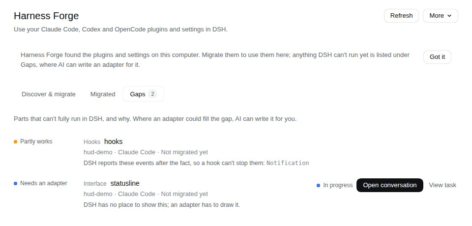

# Porting: Fill with AI

English · [中文](porting.zh.md)

Some parts have no equivalent in DSH, such as a Claude Code status line. An **adapter** can fill that gap: a small DSH plugin that rebuilds the part in DSH and, wherever it can, calls the original plugin's own code instead of copying it.

Harness Forge does not write adapters itself. It **describes the gap** and hands it to DSH's own creation mode, the agent preset `cordis` (the Plugin Manager's "let the agent create a plugin"). That agent has the dsh-doc skill, runtime inspection and the plugin manager, so it can write, install and check a plugin.

## How it goes

1. In **Gaps**, press **Fill with AI** next to a part. Harness Forge writes the task, starts a new creation-mode session with it as the first message, and opens that conversation. **View task** shows the same task first, if you want to read it.
2. **The agent asks once.** Before it writes anything, it asks a few short questions in one message, each with a default: where to keep the adapter's source (by default `~/dsh-adapters/dsh-adapter-<plugin>-<part>`, outside every workspace and the original plugin, so neither a cleanup nor an update touches it), and anything this part leaves open, for example where a status line should show. Reply "ok" to take the defaults. It talks in the language of your DSH interface.
3. **It builds on its own.** It reads the original plugin's files, writes the adapter, reusing the original's code where it can, installs it as a **local plugin** in your current profile and enables it.
4. **It checks before it says done.** It confirms the adapter loaded without errors, tries the behaviour the task names, and calls Harness Forge's `harness_verify_port` tool. Only when that tool reports the part as covered does it report done, with what it saw. Otherwise it fixes and checks again, or says exactly what blocks it.
5. Publishing is up to you. Nothing is published unless you ask, and then only under your own npm scope.



While a port session exists, the part shows **In progress** with **Open conversation**. Once `harness_verify_port` confirmed it, the part moves to **Covered by adapters** and shows **Done — verified**. This survives reloads. If you delete the session before the port is verified, the part offers **Fill with AI** again.

If your profile has no creation mode, Harness Forge says so; use **View task** and copy the task into a session yourself.

To stop offering porting, switch off the **Porting** row in DSH's **Plugins** page.

## How the check works

`harness_verify_port({ pluginId, componentId })` is a tool Harness Forge registers in DSH's global tool registry, so every agent sees it, the creation-mode preset `cordis` included. It reads the installed adapter packages again and reports three checks:

- **declared**: an installed package declares the part in `harnessForge.ports` (or is named for it);
- **enabled**: DSH's plugin manager lists that package as a bundle that is switched on and has no load error;
- **loaded**: every plugin row of the bundle is running, with no startup failure.

It answers `covered: true` only when all three pass, and records the result for the Gaps screen. You can call it yourself in any session.

## What the task contains

The task starts with the working protocol above (ask once, build, check, report), then the part's brief:

- **The original**: name, version, source, root folder on disk, license; the part's entry points and every file of it (absolute paths), the part as Harness Forge read it, and a manifest excerpt.
- **Why Harness Forge cannot run it**: the part's gaps from the assessment.
- **The nearest DSH extension points**, for example Web slots for UI surfaces, tool and agent lifecycle events for hooks, Host plugins that register tools for code. The agent is asked to confirm them with dsh-doc.
- **Questions for you**: where the source goes, with its default, and the choices this part leaves open.
- **Acceptance criteria**: the original's behaviour happens in a DSH session; the adapter calls the original's own code; it loads without errors and disabling it removes everything it registered; its `package.json` declares `harnessForge.ports`; its README says what it restores and what still differs; `harness_verify_port` reports the part covered.
- **Constraints**: package name `dsh-adapter-<plugin>-<part>`, unscoped, authored in the folder you agreed to; installed as a local plugin in the current profile only; publishing optional, only on request, under your own scope; respect the original's license; no tokens or session data in the adapter.

## How an adapter is recognized

An adapter declares the parts it covers in its `package.json`:

```json
{
  "name": "dsh-adapter-claude-hud-statusline",
  "harnessForge": { "ports": [{ "plugin": "claude-hud", "component": "statusline" }] }
}
```

A package named `dsh-adapter-…` counts even without the declaration. Once DSH's plugin manager lists it as installed and switched on (the **enabled** check above), the part shows as working through the adapter, and as checked only after it has run. A package that is only present under the profile's `node_modules`, such as a link left behind by a failed install, does not count.

## When the install stalls

Harness Forge itself does not cause this. pnpm 11 in a DSH profile can finish an install and then not exit, once another plugin has put a package with platform-specific binaries (such as `rolldown` or `lightningcss`) in the profile. DSH stops it after 10 silent minutes and reports the install as failed ("pnpm printed nothing for … and was terminated").

Install again: the agent calls `install_bundle` once more, and the second run finishes at once. If DSH was stopped meanwhile, ask any session to install the adapter directory again, or run `dsh plugin --profile <profile> add <adapter directory>` while DSH is stopped.
