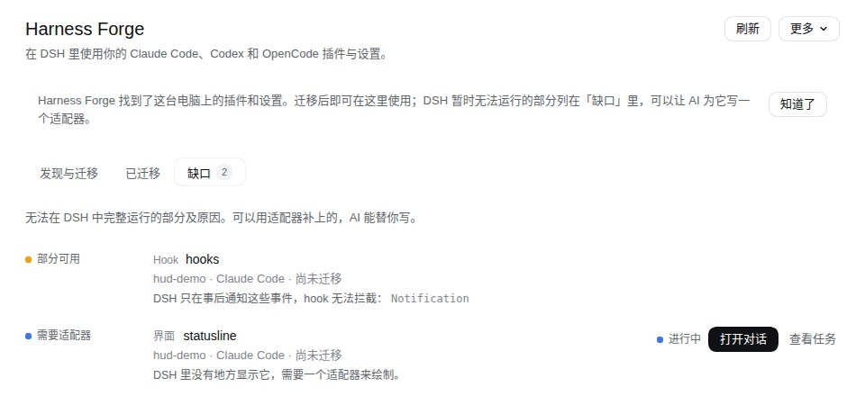

# 移植：用 AI 补上

[English](porting.md) · 中文

有些部分在 DSH 里没有对应功能，例如 Claude Code 的状态栏。**适配器** 可以补上这类缺口：一个小的 DSH 插件，在 DSH 里重建这个部分，并尽量调用原插件自己的代码，而不是复制它。

Harness Forge 自己不写适配器。它负责 **说明缺口**，然后交给 DSH 自己的创造模式，也就是智能体预设 `cordis`（插件管理里的“让 Agent 创建插件”）。这个智能体带有 dsh-doc 技能、运行时检查工具和插件管理器，能编写、安装并检查插件。

## 流程

1. 在 **缺口** 页里，点某个部分旁边的 **用 AI 补上**。Harness Forge 写好任务，新开一个创造模式的会话，把任务作为第一条消息发出，并直接打开这个对话。想先看看任务内容，可以点 **查看任务**。
2. **智能体先问一次。** 动手之前，它在一条消息里问几个简短的问题，每个都给出默认值：适配器源码放在哪里（默认 `~/dsh-adapters/dsh-adapter-<插件>-<部分>`，位于创造会话的工作目录下，与原插件分开），以及这个部分本身没定下来的事，例如状态栏显示在哪里。回复“ok”即用默认值。它用你 DSH 界面的语言和你交流。
3. **之后自己完成。** 它读取原插件的文件，编写适配器（尽量复用原插件的代码），作为 **本地插件** 装进你当前的 profile 并启用。
4. **说完成之前先自检。** 它确认适配器加载无错误，实际试一遍任务里要求的效果，再调用 Harness Forge 的 `harness_verify_port` 工具。只有这个工具报告该部分已补上，它才报告完成，并附上看到的结果；否则继续修复再检查，或者说清楚卡在哪里。
5. 是否发布由你决定。你不要求就不发布；要发布，也只发布到你自己的 npm scope 下。

在 **工作区写入** 模式下，智能体可以直接写入 `~/dsh-adapters`，但插件管理器的操作仍需逐次批准；为该会话选择 **完全访问** 即可免除这些提示。



移植会话存在期间，这个部分显示 **进行中** 和 **打开对话**。`harness_verify_port` 确认之后，它移到 **已由适配器补上**，显示 **已完成 — 已验证**。刷新页面后状态仍在。如果在验证之前删除了这个会话，这个部分会重新出现 **用 AI 补上**。

如果你的 profile 里没有创造模式，Harness Forge 会提示；可以点 **查看任务**，把任务复制到一个会话里自己处理。

不想再提供移植，就在 DSH 的 **插件** 页面关闭 **移植** 这一行。

## 如何检查

`harness_verify_port({ pluginId, componentId })` 是 Harness Forge 注册在 DSH 全局工具表里的工具，所有智能体都能看到，包括创造模式的预设 `cordis`。它重新读取已安装的适配器包，报告三项检查：

- **declared**：有已安装的包在 `harnessForge.ports` 里声明了这个部分（或按它命名）；
- **enabled**：DSH 的插件管理器把这个包列为已启用、没有加载错误的 bundle；
- **loaded**：这个 bundle 的每个插件行都在运行，没有启动失败。

三项都通过才回答 `covered: true`，并把结果记下来供“缺口”页显示。你也可以在任何会话里自己调用它。

## 任务里有什么

任务先是上面的工作流程（先问一次、完成、自检、报告），然后是这个部分的说明：

- **原插件**：名称、版本、来源、磁盘上的根目录、许可证；这个部分的入口和所有文件（绝对路径）、Harness Forge 读到的内容、清单摘录；
- **为什么 Harness Forge 运行不了它**：评估里这个部分的缺口；
- **最接近的 DSH 扩展点**：例如界面类用 Web 插槽，hook 类用工具与智能体生命周期事件，代码类用注册工具的 Host 插件；要求智能体先用 dsh-doc 核实；
- **要问你的问题**：源码放在哪里（含默认值），以及这个部分没定下来的选择；
- **验收标准**：在 DSH 会话里能看到原插件的效果；适配器调用原插件自己的代码；加载无错误，停用后它注册的东西全部撤销；`package.json` 声明 `harnessForge.ports`；README 写明恢复了什么、还有哪些不同；`harness_verify_port` 报告该部分已补上；
- **约束**：包名 `dsh-adapter-<插件>-<部分>`，不带 scope，写在你同意的文件夹里；只作为本地插件装进当前 profile；发布可选，只在你要求时、发布到你自己的 scope；遵守原插件的许可证；适配器里不放任何令牌或会话数据。

## 适配器如何被识别

适配器在 `package.json` 里声明它补上的部分：

```json
{
  "name": "dsh-adapter-claude-hud-statusline",
  "harnessForge": { "ports": [{ "plugin": "claude-hud", "component": "statusline" }] }
}
```

名为 `dsh-adapter-…` 的包即使没有声明也算。DSH 的插件管理器把它列为已安装且已启用后（即上面的 **enabled** 检查），这个部分显示为通过适配器可用；在它真正运行之前不算已核对。只出现在 profile 的 `node_modules` 下的包不算，例如安装失败后留下的链接。

## 安装卡住时

这不是 Harness Forge 引起的。其他插件把带平台相关二进制的包（如 `rolldown`、`lightningcss`）装进 profile 之后，pnpm 11 在 DSH 的 profile 里可能装完却不退出。DSH 在它连续 10 分钟没有输出后结束它，并报告安装失败（“pnpm printed nothing for … and was terminated”）。

再装一次即可：智能体会再调用一次 `install_bundle`，第二次很快完成。如果期间停掉了 DSH，让任何会话再安装一次适配器目录，或在 DSH 停止时运行 `dsh plugin --profile <profile> add <适配器目录>`。
