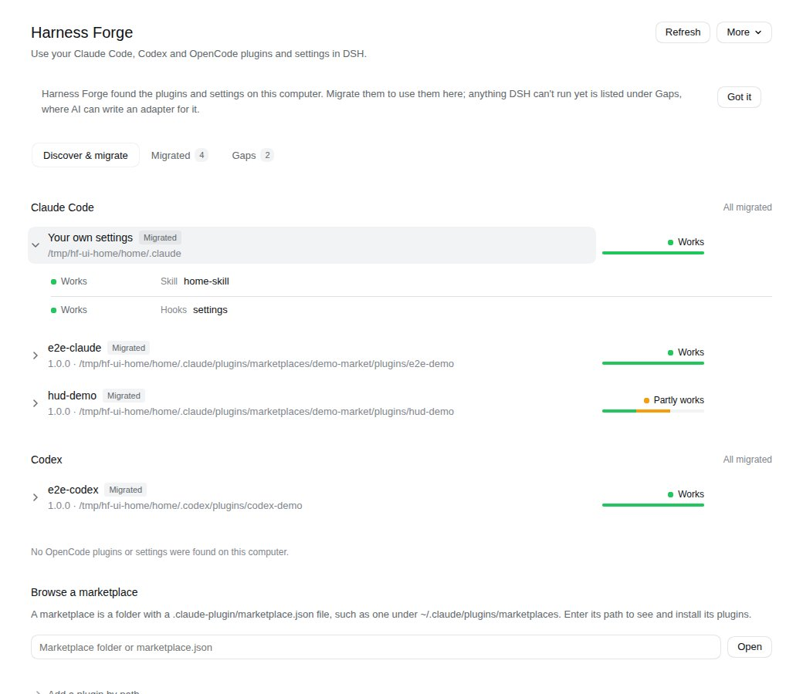
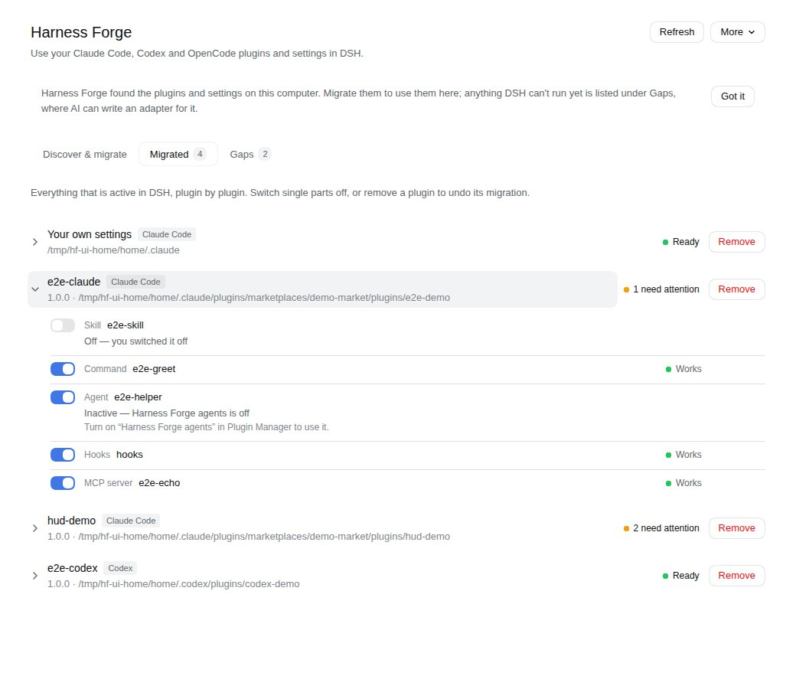

# Quick start

English · [中文](quickstart.zh.md)

## Install

Requirements: DSH 0.2.2-rc.3 or later, Node.js 22.19+ or 24+. On Windows, hooks need Git Bash (it comes with Git for Windows), as in Claude Code. OpenCode code plugins need Bun: one on `PATH` or in `~/.bun` is used, otherwise Harness Forge installs one into its own data directory the first time it is needed (or set `BUN_PATH` to a Bun executable). Claude Code mods (hooks modules) are bundled with rolldown, which Harness Forge likewise installs with npm into its data directory when the first mod loads.

In DSH, open **Plugins › Add plugin**, enter `@kirkchinese/harness-forge` and install. It goes into the profile you are using.

Or from a terminal, for the main profile that `dsh web` runs:

```sh
dsh plugin --profile web add @kirkchinese/harness-forge
```

then start DSH again. For another profile, put its name in place of `web`; the desktop app installs through **Plugins › Add plugin** only.

**Harness Forge** now appears in the DSH sidebar. The workbench follows DSH's language (English or Chinese).

## Discover & migrate



The first screen lists, per harness (Claude Code, Codex, OpenCode), what this computer has:

- **Your own settings**: skills, commands, agents, MCP servers, hooks and settings under `~/.claude` and `~/.codex`.
- **Every installed plugin**, with each of its parts marked as **works**, **partly works** or **not possible**, and the reason. Before you migrate, this is a prediction from the plugin's files; after it runs, a part is marked as checked.

Press **Migrate all** to migrate everything not migrated yet, or migrate one plugin. Migrating changes nothing in the original harness: plugins run from where they are installed.

## Get plugins from the internet

You don't need Claude Code, Codex or OpenCode installed to use their plugins. Under **Get plugins** on the same screen, paste one of these and press **Open**:

| You paste | What it is |
| --- | --- |
| `owner/repo`, `owner/repo@v2`, `https://github.com/owner/repo` | A GitHub repository: a Claude Code or Codex marketplace, or a single plugin |
| `https://github.com/owner/repo/tree/main/plugins/x` | One plugin inside a larger repository |
| Any git URL (`https://…`, `git@host:path`, `ssh://…`), optionally with `#ref` | A marketplace or plugin on another git host |
| `https://example.com/marketplace.json` | A marketplace file on a website. Its plugins must point at their own repositories, because the website has no other files |
| `opencode-wakatime`, `@scope/name@1.2.0` | An OpenCode plugin on npm |
| A folder path | A marketplace or plugin already on disk |

These marketplaces are listed ready to open. Each one is fetched only when you open it:

- `claude-plugins-official` (`anthropics/claude-plugins-official`) and `claude-community` (`anthropics/claude-plugins-community`): [Anthropic's official and community marketplaces](https://code.claude.com/docs/en/plugins/anthropic-marketplaces)
- `anthropic-agent-skills` (`anthropics/skills`) and `knowledge-work-plugins` (`anthropics/knowledge-work-plugins`): Anthropic's topic marketplaces
- `openai-curated` (`openai/plugins`): OpenAI's [Codex plugins](https://developers.openai.com/codex/plugins/build)

Press **Install** on a plugin. Harness Forge fetches it and shows a confirmation before it installs anything. The confirmation lists where the plugin comes from (with a link), the exact commit or version, and every part with whether it works in DSH. It also warns you when the plugin has hooks, MCP servers, settings or code, because those run with your permissions. Confirm, and the plugin appears in **Migrated** like any other.

- **Where files go.** Downloads go into Harness Forge's own folder, `<profile>/.harness-forge/data/remote/`. Nothing is written into `~/.claude`, `~/.codex`, OpenCode's configuration or your DSH profile's configuration. Each install keeps its own copy, pinned to the commit it was fetched at.
- **git or not.** With git installed, Harness Forge makes a shallow clone; for a plugin in a subfolder it is also sparse. Without git, which is common on Windows, GitHub repositories are downloaded as an archive over HTTPS. Other git hosts need git.
- **Updates.** Under **Installed from the internet**, press **Check for updates**. It compares each plugin's commit (or npm version) with what its source points at now. **Update** fetches exactly the revision the check found and shows it for confirmation, like an install: what's new or changed, and whether it runs code. Only then is it applied, and parts you switched off stay off.
- **Removal.** Remove the plugin in **Migrated**; its downloaded files are deleted with it.
- **Proxies.** Harness Forge, git and npm use the proxy in `HTTPS_PROXY`, `HTTP_PROXY` or `ALL_PROXY`, minus the hosts in `NO_PROXY`. Through a proxy, Harness Forge reaches only GitHub (`github.com`, `codeload.github.com`, `api.github.com`, `raw.githubusercontent.com`, `objects.githubusercontent.com`), npm's registry (`registry.npmjs.org`) or yours, and the hosts of sources you paste. A marketplace that points elsewhere is refused, with the host named.
- **Not supported.** Marketplace entries that run a command (`"source": "command"`) are listed but can't be installed, since that would run a command from the marketplace on your computer. The same goes for zip archives in the ZIP64 format.

The same box also opens a marketplace folder already on disk, for example one under `~/.claude/plugins/marketplaces`.

## Migrated

Everything active in DSH, plugin by plugin. Switch single parts off, sign in to remote MCP servers that need it, or remove a plugin to undo its migration.



## Gaps

Every part that cannot fully run in DSH, and why. Where an adapter could fill the gap, **Fill with AI** starts a creation-mode session that writes the adapter and opens it right away; the part shows **In progress** until the agent has verified the adapter, then **Done — verified**. See [porting](porting.md).


## More

| Screen | What it is for |
|---|---|
| Import sessions | Import Claude Code, Codex and OpenCode sessions as DSH sessions and open them at once to continue them in DSH. Importing one again opens the session it became. While [dsh-chat-import](https://github.com/Nwflower/dsh-chat-import) is installed, this screen points to its **Import sessions** button in the sidebar instead |
| Settings | Extra folders to search for plugins, whether to discover automatically, and which CLAUDE.md / AGENTS.md files are added to new sessions |
| Diagnostics | Rows that failed, parts that failed to mount, the shell hooks run in, Bun, and the Harness Forge, DSH and Node.js versions: what to include in a bug report |


**Works well with dsh-chat-import.** For more sources (40+ agents) and options, install [dsh-chat-import](https://github.com/Nwflower/dsh-chat-import): **Install** on the first-run banner or on the Import sessions screen asks first, then installs it through DSH's plugin manager. Without the plugin manager, run `dsh plugin --profile web add dsh-chat-import`.

## In a conversation

The model can use Harness Forge directly through its tools: `harness_status`, `harness_discover`, `harness_capabilities`, `harness_scan`, `harness_plan`, `harness_install` and `harness_mcp_login`. A bundled skill, `harness-forge`, tells it when to use them. You can also type:

```text
/harness status | list | roots
/harness scan <path> [source] | plan <path> [source] | import <path> [source]
/harness undo <receipt-id> | remove <plugin-id> | login <server>
```

## Configuration

All optional. The main row (`harness-forge`):

| Field | Meaning |
|---|---|
| `modelAliases` | Which model a Claude alias (`haiku`, `sonnet`, `opus`) runs on, as `provider/model`. Without an entry the session's model is used |
| `preload` | Plugin folders migrated at startup |
| `debug` | Write lifecycle diagnostics to `debug.log` next to Harness Forge's state (`<profile>/.harness-forge/`) |

The skills row (`harness-forge-skills`) takes `skillRoots`: extra folders scanned for `SKILL.md` skills. Every skill in such a folder is served as it is, without import or review. An imported plugin's skills are different: only the skills that were imported and are switched on are served, even when other skills sit in the same folder.

```yaml
- id: harness-forge
  config:
    modelAliases:
      opus: deepseek-official/deepseek-flash
- id: harness-forge-skills
  config:
    skillRoots: [/home/me/shared-skills]
```

## Safety

Migrated hooks, MCP servers and plugin code run with your permissions, as they do in their original harness. Migrate only plugins you trust. The same goes for plugins from the internet: check the source and contents in the confirmation before you install.
