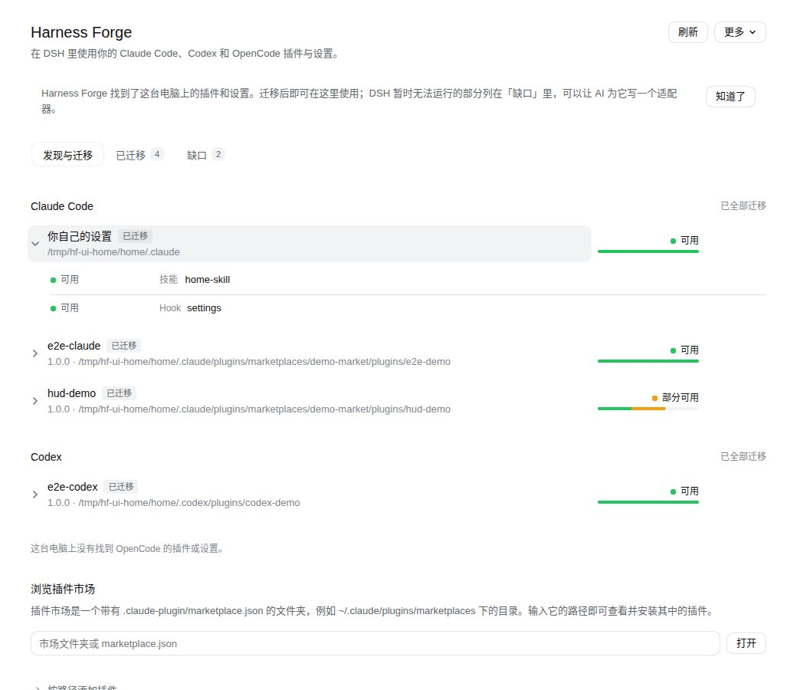
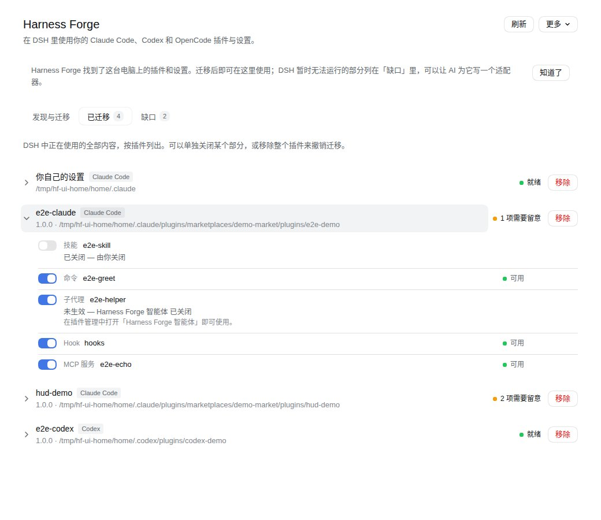
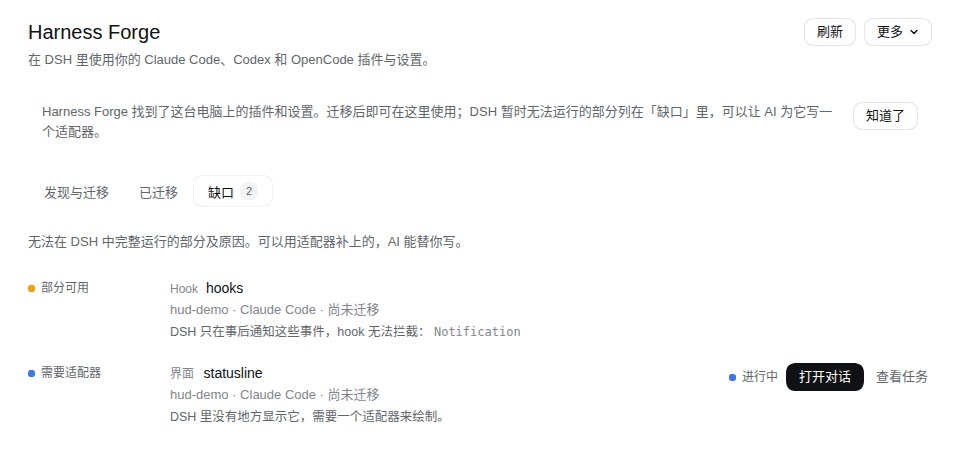
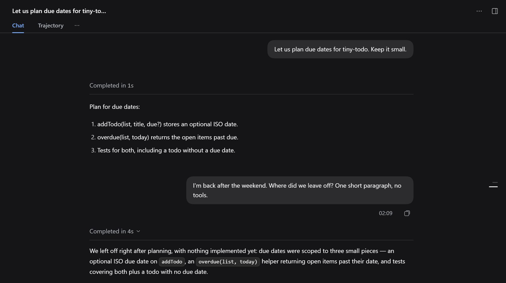

# 快速开始

[English](quickstart.md) · 中文

## 安装

要求：DSH 0.2.2-rc.3 或更新、Node.js 22.19+ 或 24+。Windows 上运行 hook 需要 Git Bash（随 Git for Windows 安装），与 Claude Code 相同。OpenCode 代码插件需要 Bun：优先用 `PATH` 上或 `~/.bun` 里的，没有的话 Harness Forge 会在第一次用到时装一份到自己的数据目录（也可以用 `BUN_PATH` 指定 Bun 可执行文件）。Claude Code 的 mods（hooks 模块）用 rolldown 打包，同样在第一个 mod 加载时由 Harness Forge 用 npm 装到自己的数据目录。

在 DSH 里打开 **插件 › 添加插件**，输入 `@kirkchinese/harness-forge` 并安装，它会装进你正在使用的 profile。

也可以在终端里装到 `dsh web` 使用的主 profile：

```sh
dsh plugin --profile web add @kirkchinese/harness-forge
```

然后重新启动 DSH。要装到其他 profile，把 `web` 换成它的名字；桌面版只能通过 **插件 › 添加插件** 安装。

之后 DSH 侧边栏里会出现 **Harness Forge**。工作台跟随 DSH 的语言（中文或英文）。

## 发现与迁移



第一个页面按来源（Claude Code、Codex、OpenCode）列出这台电脑上有什么：

- **你自己的设置**：`~/.claude` 和 `~/.codex` 下的技能、命令、智能体、MCP 服务、hook 和设置；
- **每个已安装的插件**：它的每个部分标为 **可用**、**部分可用** 或 **无法使用**，并写明原因。迁移前这是根据插件文件做的预计；实际运行过之后，这个部分会标为已核对。

这里只列出你在原工具里真正安装过的插件：Claude Code 的 `installed_plugins.json` 里用户范围（user scope）的安装、Codex 的 `config.toml` 中 `[plugins]` 列出的，以及 OpenCode 的 `~/.config/opencode/plugins`（或 `plugin`）文件夹下直接放着的插件文件和插件包、`~/.config/opencode/opencode.json(c)` 里配置的插件包。插件市场只是提供、你并没有安装的插件，以及原工具缓存里留下的其他版本，都不会列出；这些插件市场改为列在 **获取插件** 里（见下文）。只为某个项目安装的 Claude Code 插件（`--scope project` 或 `--scope local`）也不列出：它只在那个项目的会话里加载。

点 **全部迁移** 迁移所有尚未迁移的内容，或者逐个插件迁移。迁移不会改动原工具里的任何东西：插件从原来的安装位置运行。在 Claude Code（`enabledPlugins`）或 Codex（`enabled = false`）里关掉的插件仍会列出，并标为 **已在 Claude Code 中关闭** 或 **已在 Codex 中关闭**；**全部迁移** 不会带上它，也不计入数量。你仍可以单独迁移它，这会让它在 DSH 里启用。

## 从网络获取插件

不用安装 Claude Code、Codex 或 OpenCode，也能使用它们的插件。在同一页面的 **获取插件** 里粘贴下面任意一种，然后点 **打开**：

| 粘贴的内容 | 含义 |
| --- | --- |
| `owner/repo`、`owner/repo@v2`、`https://github.com/owner/repo` | GitHub 仓库：Claude Code 或 Codex 的插件市场，或单个插件 |
| `https://github.com/owner/repo/tree/main/plugins/x` | 大仓库里的某一个插件 |
| 任意 git 地址（`https://…`、`git@host:path`、`ssh://…`），可加 `#ref` | 其他 git 托管站点上的插件市场或插件 |
| `https://example.com/marketplace.json` | 网站上的市场文件；网站上没有其他文件，所以其中的插件必须指向各自的仓库 |
| `opencode-wakatime`、`@scope/name@1.2.0` | npm 上的 OpenCode 插件 |
| 文件夹路径 | 已在磁盘上的插件市场或插件 |

下面这些插件市场已经列好，点开时才会获取：

- `claude-plugins-official`（`anthropics/claude-plugins-official`）和 `claude-community`（`anthropics/claude-plugins-community`）：[Anthropic 的官方与社区插件市场](https://code.claude.com/docs/en/plugins/anthropic-marketplaces)
- `anthropic-agent-skills`（`anthropics/skills`）和 `knowledge-work-plugins`（`anthropics/knowledge-work-plugins`）：Anthropic 的专题插件市场
- `openai-curated`（`openai/plugins`）：OpenAI 的 [Codex 插件](https://developers.openai.com/codex/plugins/build)

在插件上点 **安装**，Harness Forge 会先获取插件并显示确认框，确认之前不会安装任何东西。确认框会列出插件的来源（带链接）、确切的提交或版本，以及每个部分是否能在 DSH 中使用。确认框还会列出会以你的权限运行代码的部分（hook 及其事件、MCP 服务及其命令、命令或技能里的 shell 行、状态栏等脚本、代码插件），并说明每个部分安装后会在 DSH 中运行，还是一个缺口、在你制作适配器之前什么都不运行（适配器会运行它自己的代码）。确认后，插件会像其他插件一样出现在 **已迁移** 里。

- **文件存放位置。** 下载的内容放在 Harness Forge 自己的目录 `<profile>/.harness-forge/data/remote/`，不会写入 `~/.claude`、`~/.codex`、OpenCode 的配置或 DSH 配置文件。每次安装都保留一份自己的副本，并固定在获取时的提交上。
- **有没有 git。** 装了 git 时，Harness Forge 会做浅克隆；如果插件在子目录里，还只检出那个子目录。没有 git 时（Windows 上很常见），GitHub 仓库会通过 HTTPS 下载压缩包；其他 git 托管站点需要 git。
- **更新。** 在 **通过“获取插件”安装** 下点 **检查更新**，它会把每个插件的提交（或 npm 版本）与来源当前指向的版本比较。**更新** 会获取检查时找到的那个版本，先像安装一样请你确认（显示哪些部分是新增的、哪些有改动，以及它是否会运行代码），确认后才应用，你关掉的部分保持关闭。
- **移除。** 在 **已迁移** 中移除插件，它下载的文件会一并删除。
- **代理。** Harness Forge、git 和 npm 都会使用 `HTTPS_PROXY`、`HTTP_PROXY` 或 `ALL_PROXY` 中的代理，并跳过 `NO_PROXY` 中的主机。通过代理时，Harness Forge 只访问 GitHub（`github.com`, `codeload.github.com`, `api.github.com`, `raw.githubusercontent.com`, `objects.githubusercontent.com`）、npm 官方仓库（`registry.npmjs.org`）或你配置的仓库，以及你粘贴的来源所在的主机。插件市场如果指向其他主机，会被拒绝，并给出主机名。
- **不支持的内容。** 需要运行命令的市场条目（`"source": "command"`）会列出但不能安装，因为那会在你的电脑上运行市场提供的命令。ZIP64 格式的 zip 压缩包同样不支持。

原工具添加过的插件市场（Claude Code 的 `known_marketplaces.json`、Codex 的本地 `[marketplaces]`）列在 **本机** 下。其中的插件不会随 **全部迁移** 一起迁移：打开市场后，按需逐个安装，每次安装都会先经过上面同样的确认，列出插件包含的部分以及哪些会运行代码。Harness Forge 安装的是打开确认界面时复制的一份副本，插件市场的文件夹保持原工具管理的样子。同一个输入框也可以打开其他已在磁盘上的插件市场文件夹。

## 已迁移

在 DSH 里生效的所有内容，按插件列出。可以关闭单个部分，为需要登录的远程 MCP 服务登录，或者移除一个插件来撤销它的迁移。



已迁移的插件会跟随安装它的原工具。Claude Code 和 Codex 会把插件的每个新版本放进单独的文件夹，并可能删掉旧的。原工具更新了插件后，下次 DSH 启动或这个页面加载时，Harness Forge 会把已迁移的插件移到新版本的文件夹，你关掉的部分保持关闭。插件随后显示 **已随 Codex 从 1.0 更新到 1.1**（或随 Claude Code）。

原工具不再运行某个已迁移的插件时，它在 DSH 里也不再运行。这包括你在原工具里卸载或关掉的插件，也包括早期版本的 Harness Forge 从原工具文件夹里迁移、但原工具从未安装过的插件（插件市场只是提供的插件，或者被当成 Claude Code 插件读取的 Codex 插件）。这样的插件仍会列出并写明原因。选 **保留** 会把它留作你自己的副本：它从现在所在的文件夹运行，不再跟随原工具。选 **移除** 会移除它。如果你迁移时插件在原工具里本来就是关闭的，它会继续运行。原工具自己的记录读不完整时（格式有误，或正赶上原工具在写它），从它迁移来的插件一律不变：“诊断”会说明是哪份记录，下次加载时再读。文件夹已经不在的插件，每个部分都显示为错误，并说明这一点。

DSH 启动后，已迁移的插件要重新应用一遍，每个大约一秒。全部完成之前，**发现与迁移** 和 **已迁移** 会显示 **正在应用已迁移的插件：已完成 N / M…**，列表会自己补全。

## 缺口

所有无法在 DSH 里完整运行的部分及原因。能由适配器补上的，点 **用 AI 补上** 会直接开一个创造模式的会话来编写适配器并打开它；在智能体验证适配器之前，这个部分显示 **进行中**，验证之后显示 **已完成 — 已验证**。见 [移植](porting.zh.md)。



## 更多

| 页面 | 用途 |
|---|---|
| 导入会话 | 把 Claude Code、Codex、OpenCode 的会话导入为 DSH 会话，导入后可以立即打开，在 DSH 里接着聊。再次导入同一个会话会打开之前导入的那个。打开时会让 DSH 重新认得这个会话（放进它所在文件夹的工作区，并让它处于可用状态），如果你在 DSH 里归档过它，会先把它移出归档；DSH 没有提供移出归档的办法时，页面会明确说它已归档。Codex 的子代理线程不会列出，但旧版本导入过的那一份会继续列出，标为已导入，并有 **打开会话** 按钮。旧版本给 Codex 线程和它的分叉用的是同一个会话 id。这样的会话要和线程的创建时间相同，才算是这个线程。如果还有同一时间创建的别的线程共用这个 id，还要逐轮对比你说的话和助手的回答，全部一致才算，而且这些线程里只能有一个完全一致。对比出不同的线程会作为新会话导入。没有一个完全一致（一方只是另一方的开头），或者有好几个都完全一致时，这一行同时提供 **打开已有会话** 和 **作为新会话导入**。装有 [dsh-chat-import](https://github.com/Nwflower/dsh-chat-import) 时，这个页面改为指向侧边栏里它的 **导入会话** 按钮 |
| 设置 | 额外搜索插件的文件夹、是否自动发现，以及哪些 CLAUDE.md / AGENTS.md 文件会加入新会话 |
| 诊断 | 启动失败的行、挂载失败的部分、hook 使用的 shell、Bun，以及 Harness Forge、DSH 和 Node.js 的版本：报告问题时附上这些 |



**搭配 dsh-chat-import。** 想导入更多来源（40 多种智能体）、需要更多选项，可以安装 [dsh-chat-import](https://github.com/Nwflower/dsh-chat-import)：首次打开时的提示条或导入会话页面上的 **安装** 会先确认，再通过 DSH 的插件管理器安装。没有插件管理器时，运行 `dsh plugin --profile web add dsh-chat-import`。

## 在对话里使用

模型可以通过工具直接使用 Harness Forge：`harness_status`、`harness_discover`、`harness_capabilities`、`harness_scan`、`harness_plan`、`harness_install` 和 `harness_mcp_login`。随包的 `harness-forge` 技能告诉它何时使用这些工具。你也可以输入命令：

```text
/harness status | list | roots
/harness scan <path> [source] | plan <path> [source] | import <path> [source]
/harness undo <receipt-id> | remove <plugin-id> | login <server>
```

## 配置

全部可选。主行（`harness-forge`）：

| 字段 | 含义 |
|---|---|
| `modelAliases` | Claude 别名（`haiku`、`sonnet`、`opus`）使用哪个模型，写作 `provider/model`。不写时使用会话的模型 |
| `preload` | 启动时自动迁移的插件文件夹 |
| `debug` | 把生命周期诊断写到 Harness Forge 状态旁的 `debug.log`（`<profile>/.harness-forge/`） |

技能行（`harness-forge-skills`）接受 `skillRoots`：额外扫描 `SKILL.md` 技能的文件夹。这类文件夹里的每个技能都会原样提供，不经导入或审核。导入插件的技能则不同：只提供已导入且处于开启状态的技能，即使同一文件夹里还有其他技能。

```yaml
- id: harness-forge
  config:
    modelAliases:
      opus: deepseek-official/deepseek-flash
- id: harness-forge-skills
  config:
    skillRoots: [/home/me/shared-skills]
```

## 安全

迁移来的 hook、MCP 服务和插件代码以你的权限运行，与在原工具里相同。只迁移你信任的插件；从网络安装的插件也一样，安装前请看确认框里的来源和内容。
