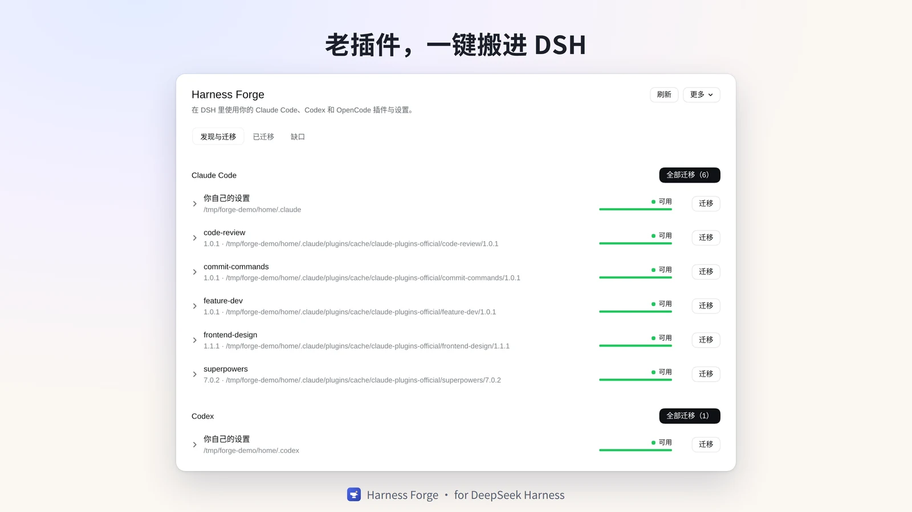

# Harness Forge



在 [DeepSeek Harness](https://github.com/deepseek-ai/deepseek-harness)（DSH）里使用你的 Claude Code、Codex 和 OpenCode 插件与设置：技能、斜杠命令、子代理、hook、MCP 服务（stdio、HTTP、SSE、OAuth）、Claude Code mods 和 OpenCode 代码插件，你的 `~/.claude` 和 `~/.codex` 设置，DSH 自己不读的指令文件，以及可以接着聊的历史会话。转换在运行时完成，原来的安装保持原样。

在 DSH 里：打开 **插件 › 添加插件**，输入 `@kirkchinese/harness-forge`。也可以在终端里装到 `dsh web` 使用的主 profile：

```sh
dsh plugin --profile web add @kirkchinese/harness-forge
```

需要 DSH 0.2.2-rc.3 或更新版本、Node.js 22.19+ 或 24+；在 Windows 上，hook 在 Git Bash 里运行。

## 使用

在 DSH 侧边栏打开 **Harness Forge**：

- **发现与迁移** 列出这台电脑上找到的插件和你自己的设置，逐项标出可用、部分可用或无法使用并写明原因，然后迁移它们（**全部迁移**）。这里也可以浏览插件市场。
- **已迁移** 可以关闭单个部分或撤销迁移。
- **缺口** 列出无法完整运行的部分及原因。**用 AI 补上** 会在 DSH 的创作模式里开一个会话，构建一个本地适配器插件（`dsh-adapter-<插件>-<部分>`）；是否发布由你决定，发布时用你自己的 npm scope。

另外还有：**导入会话**、**设置**、**诊断**。模型可以使用 `harness_*` 工具，你也可以输入 `/harness status | list | scan | plan | import | undo | remove | roots | login`。

## 行

这个包为每种能力安装一个 DSH 插件行：Harness Forge（其他行都依赖它）、技能、命令、智能体、hook、MCP 服务、Claude Code mods、OpenCode 插件、指令、会话、移植和工作台（workbench）。每一行都可以在 DSH 的 **插件** 页单独关闭，不影响其他行。

## 搭配使用

[dsh-chat-import](https://github.com/Nwflower/dsh-chat-import) 把 Claude Code、Codex、OpenCode 和其他 40 多种智能体的对话导入为可以接着聊的 DSH 会话。安装它之后，Harness Forge 自己的会话导入会让位给它；在 **更多 → 导入会话** 里（或首次打开时的横幅上）点 **安装**，即可通过 DSH 的插件管理器安装它。

## 安全

迁移过来的 hook、MCP 服务和插件代码以你的权限运行，和在原工具里一样。只迁移你信任的插件。

## 文档

- [快速开始](https://github.com/kirkchinese/harness-forge/blob/main/docs/user/quickstart.zh.md)
- [兼容性](https://github.com/kirkchinese/harness-forge/blob/main/docs/user/compatibility.zh.md)
- [移植（用 AI 补上）](https://github.com/kirkchinese/harness-forge/blob/main/docs/user/porting.zh.md)
- [架构](https://github.com/kirkchinese/harness-forge/blob/main/docs/architecture/overview.md)（英文）
- [更新日志](https://github.com/kirkchinese/harness-forge/blob/main/CHANGELOG.md)（英文）

完整的中文说明：[README](https://github.com/kirkchinese/harness-forge/blob/main/README.zh.md)。

## 许可证

MIT
